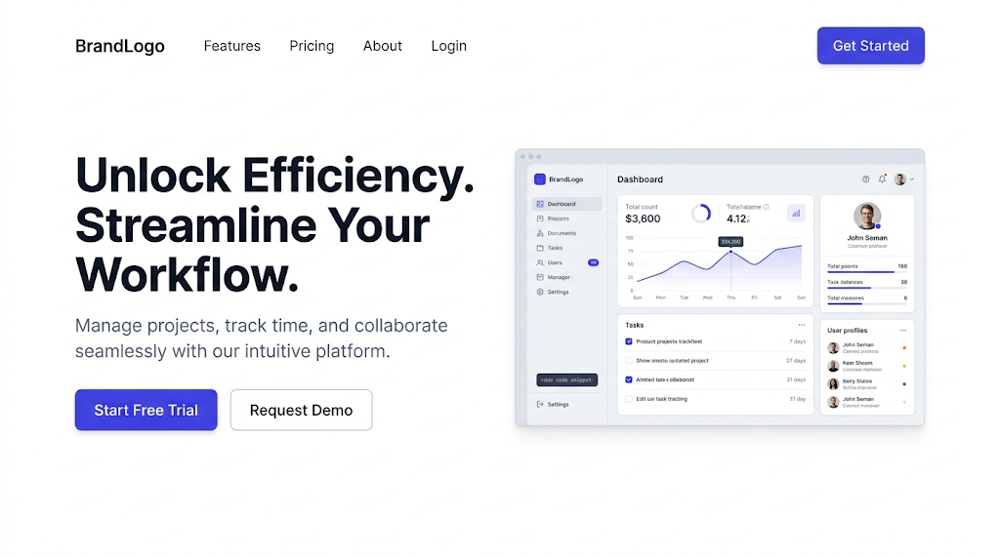

# Minimalismo funcional (Clean SaaS)

Orden, aire y un solo color de acción. La interfaz desaparece y el producto se ve.
Encaja con esqueleto **C** (producto) y **A** (conversión).

## 1. Paleta de entrada
<!-- hex-allowed -->
| Rol | Ejemplo |
|---|---|
| surface (claro / oscuro) | `#FFFFFF` / `#0F172A` |
| outline-variant (claro / oscuro) | `#E2E8F0` / `#1E293B` |
| primary | `#4F46E5` (índigo) o `#2563EB` (azul eléctrico) |
<!-- /hex-allowed -->

## 2. Roles
- `primary`: el único color saturado. Solo CTA, enlaces y un dato destacado.
- `secondary`: gris pizarra casi negro para texto y estructura.
- `tertiary`: verde o ámbar apagado solo para estados (badges).
- Fondo claro por defecto; `Section tone="surface"` en gris muy tenue para alternar.
- `outline-variant` visible: los bordes finos son la estructura.

## 3. Tipografía
- **a (display/headline/title):** Geist · Manrope · Figtree, 600–700.
- **b (base) y d (body/subtitle):** la misma familia, 400–500.
- **c (label, botones):** la misma, 500; `Geist Mono` solo para etiquetas de código.
- `_text.scss`: sin `text-transform: uppercase`; `letter-spacing: -0.02em` en display y
  headline; line-height de display ~1.05. Medir el titular del comp con `font-match`.
- Evitar Inter y Plus Jakarta Sans como display (lista de impeccable).
## 4. Forma
`--radius-md: 12px` · `--form-radius-btn: 8px` (no pill) · `--form-radius-input: 8px`.
Botón primario relleno; secundario con borde `outline`.

## 5. Gestos permitidos en `<slug>.scss`
- Tarjeta con borde fino + micro-sombra (`style-to-render.md` → Forma y Sombra).
- Captura de producto en `Media` con borde fino y sombra difusa del `primary` al 10 %.
- Badge mono en mayúsculas pequeñas sobre el titular del hero.

## 6. Primitivas típicas
`Container` + `Col lg 6/6` para el hero split · `AutoGrid 240` de `Card variant="bordered"`
para features · `Grid`+`Cell span` si el bloque de features es bento · `Accordion` para FAQ.

## 7. Qué muestra la imagen y cómo se construye

La imagen es el **comp aprobado** cuando el usuario la elige: se reproduce su composición
región por región ([comp-led.md](../comp-led.md)). El copy se reescribe para la marca; la
posición, la escala y el material se respetan.

| Región de la imagen | Kind | En este repo |
|---|---|---|
| Nav: wordmark, 4 enlaces, botón índigo "Get Started" | `chrome` | `Header` del toolkit con `showButton` |
| Titular 3 líneas, tinta, izquierda (col 1–6) | `text` | `Text variant="display"` en `Col lg 6` |
| Bajada gris | `text` | `Text variant="subtitle" textColor="color-on-surface-var"` |
| Dos botones: relleno índigo + borde | `control` | `Button variant="primary"` + `Button variant="secondary"` en `Cluster` |
| Captura del dashboard con marco y sombra (col 7–12) | `image` | `Media ratio="16/10"` + captura real del producto o foto de stock de pantalla; `.<slug>__frame` con borde `outline-variant` y sombra difusa |
| Fondo blanco, nada más | `band` | `Section rhythm="airy"` |

La captura del producto es la única imagen. Si no existe el producto, foto de stock de una pantalla, marcada de muestra.

## 8. Anti-patrones
- Hero centrado con titular genérico + gradiente morado detrás: el cliché SaaS.
- Tres tarjetas idénticas de icono-título-texto como única sección de features.
- Más de un color saturado.
