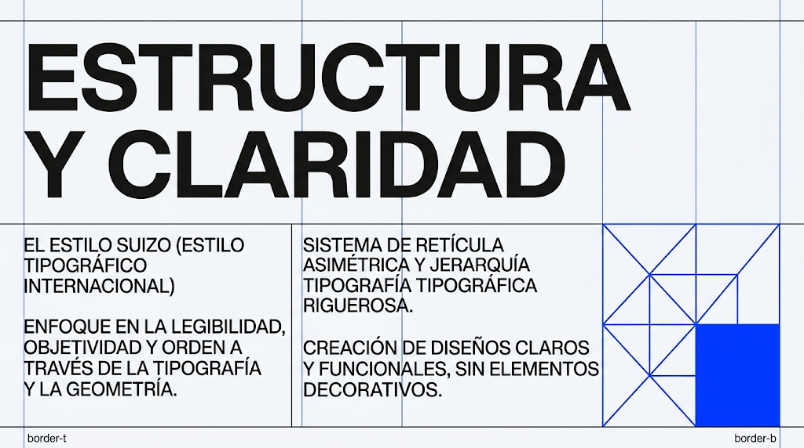

# Estilo suizo

Retícula matemática, jerarquía tipográfica rigurosa, cero decoración. La forma sigue a la
estructura. Encaja con **B** (editorial) y **A**.

## 1. Paleta de entrada
<!-- hex-allowed -->
| Rol | Ejemplo |
|---|---|
| surface | `#F8F9FA` (hueso) |
| tinta | `#111111` (carbón) |
| acento único | rojo suizo `#E63946` · ultramar `#0038FF` · ocre |
<!-- /hex-allowed -->

## 2. Roles
- `primary`: el acento único. Aparece poco: CTA y un bloque geométrico.
- `secondary`: carbón — texto, líneas de retícula, todo lo demás.
- `tertiary`: igual a `secondary` o un gris neutro; no hay tercer color.
- `outline` = `outline-variant` = tinta (líneas visibles al 100 %).

## 3. Tipografía
- **a (display/headline/title):** Archivo (ancho normal, 700–800) · Schibsted Grotesk ·
  Hanken Grotesk.
- **b (base) y d (body/subtitle):** la misma familia, 400. En la imagen el cuerpo va en
  mayúsculas: `text-transform: uppercase` en `.text-body` si se quiere igual.
- **c (label, botones):** la misma, mayúsculas pequeñas.
- `_text.scss`: display enorme — lg ~120px, md ~80px, sm ~52px — line-height 0.9,
  `letter-spacing: -0.03em`. El contraste de escala es el diseño.
- No Inter como display (lista de impeccable); Helvetica no está en Google Fonts.
## 4. Forma
`--radius-md: 0` · `--form-radius-btn: 0` · campos `0`. Sin sombras.

## 5. Gestos permitidos en `<slug>.scss`
- Líneas de retícula visibles como bordes de las celdas (`border-inline-start`,
  `border-top`), nunca `div` vacíos.
- Un bloque geométrico del acento (cuadrado, diagonal) como único elemento gráfico.

## 6. Primitivas típicas
`Grid`+`Cell` asimétrico (titular `span 9`, columnas de texto `span 4/4/4`) ·
`Section rhythm="airy"` · `Stack gap={4}` dentro de columnas estrechas.

## 7. Qué muestra la imagen y cómo se construye

La imagen es el **comp aprobado** cuando el usuario la elige: se reproduce su composición
región por región ([comp-led.md](../comp-led.md)). El copy se reescribe para la marca; la
posición, la escala y el material se respetan.

| Región de la imagen | Kind | En este repo |
|---|---|---|
| Titular enorme a todo el ancho, 2 líneas | `text` | `Text variant="display"` en `Cell span={{lg:12}}`; escala lg ~120px |
| Líneas verticales azules finas de la retícula | `chrome` | `border-inline-start: 1px solid var(--color-primary)` en las `Cell` de texto (`.<slug>__rule`) |
| Dos columnas de texto en mayúsculas | `text` | `Cell span={{lg:4}}` × 2 con `Stack` de `Text variant="body"` |
| Bloque geométrico azul (cuadrado + triángulos) abajo a la derecha | `plate` | SVG propio con `fill="var(--color-primary)"` y `stroke` en `Cell start={{lg:10}} span={{lg:3}}`; es geometría, no foto |
| Etiquetas "border-t / border-b" en las esquinas | `text` | `Text variant="label"` con `border-top/bottom: 1px solid var(--color-on-surface)` |
| Fondo hueso, sin más | `band` | `Section rhythm="airy"` |

Todo es tipografía y geometría: se construye entero con tokens, sin fotos ni plates externos.

## 8. Anti-patrones
- Centrar cosas. La retícula suiza alinea a la izquierda y a líneas.
- Sombras, gradientes, blur, radios.
- Líneas de retícula que no coinciden con las columnas reales (`Cell`).
