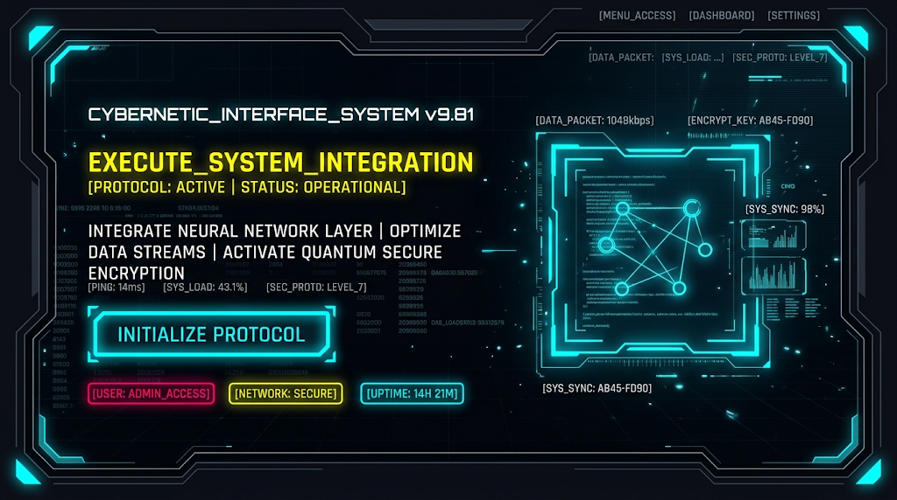

# Cyberpunk / dark tech

Interfaz tipo HUD: bordes anidados, esquinas recortadas, datos por todas partes, neón sobre
negro. Solo si el producto es técnico o de juego y la densidad de datos es real. Encaja con
**C**.

## 1. Paleta de entrada
<!-- hex-allowed -->
| Rol | Ejemplo |
|---|---|
| surface | `#05050A` |
| neón 1 | cian eléctrico `#00F0FF` |
| neón 2 | amarillo neón `#FFE600` |
| neón 3 | magenta `#FF0055` |
<!-- /hex-allowed -->

## 2. Roles
- Landing **oscura**.
- `primary`: cian (CTA, bordes activos).
- `tertiary`: amarillo (titular de acción, una vez por viewport).
- `error` teñido con el magenta de la marca; `cuaternary` = magenta para chips.
- `outline`: `primary` al 50 %.

## 3. Tipografía
- **a (display):** Orbitron · Chakra Petch.
- **b (texto):** Chakra Petch 400 · Rajdhani.
- **c/d (datos, chips):** JetBrains Mono · Share Tech Mono.
- `_text.scss`: display y headline en mayúsculas con `letter-spacing: 0.04em`; label mono.
- No Space Mono ni IBM Plex (lista de impeccable).

## 4. Forma
`--radius-md: 0` · `--form-radius-btn: 0`. Esquinas con `clip-path` en vez de radio.

## 5. Gestos permitidos en `home.scss`
- Brillo neón (`box-shadow` con `color-mix` del `primary`) en CTA y marco principal.
- Esquinas recortadas con `clip-path`.
- Scanlines o retícula tenue de fondo con `repeating-linear-gradient`.

## 6. Primitivas típicas
`Grid`+`Cell` para el HUD (panel principal + paneles laterales) · `Cluster` de chips de
estado · `Stack gap={2}` para bloques densos de datos.

## 7. Anti-patrones
- Texto de relleno pseudo-técnico (`SYS_LOAD`, `ENCRYPT_KEY`) sin significado: ruido.
- Neón en párrafos: ilegible. El neón es para bordes y titulares.
- Animaciones de glitch permanentes (accesibilidad y fatiga).
- **Romper el cliché (obligatorio para pasar `shape`):** fondo no negro (azul petróleo muy
  oscuro, verde fósforo), un solo neón en vez de tres, o datos reales del producto.

## 8. Imagen de referencia

- Marco HUD con esquinas en L brillantes y paneles anidados.
- Titular amarillo como la acción; CTA cian con brillo y esquinas recortadas.
- Chips de estado encajonados con borde de color.
