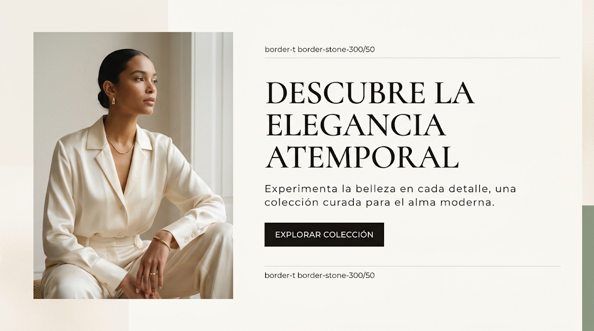

# Lujo editorial

Fondo cálido, serif de alto contraste, mucho espacio negativo, foto grande. Lento y caro.
Encaja con **B** (editorial) y **D** (hospitalidad).

## 1. Paleta de entrada
<!-- hex-allowed -->
| Rol | Ejemplo |
|---|---|
| surface | `#FBF9F5` / `#F4F0EA` (hueso, crema) |
| tinta | `#1A1817` (espresso) |
| acento | oro champán `#D4AF37` o salvia `#8A9A86` |
<!-- /hex-allowed -->

## 2. Roles
- `primary`: espresso — el CTA es un bloque oscuro sobrio, no un color.
- `secondary`: el acento (oro o salvia), en filetes y detalles.
- `tertiary`: un segundo neutro cálido para `Section tone="surface"`.
- `outline-variant`: `outline` al 50 % (hairlines).

## 3. Tipografía
- **a (display):** Bodoni Moda · Gloock · Italiana.
- **b (texto):** Jost · Montserrat 300–400, interletrado amplio.
- **c (label):** la de b en mayúsculas, `letter-spacing: 0.12em`.
- **d:** igual a b.
- `_text.scss`: display en mayúsculas o versalitas, line-height 1.0, peso 400; body con
  line-height generoso.
- No Playfair, Cormorant ni Lora (lista de impeccable).

## 4. Forma
`--radius-md: 0` · `--form-radius-btn: 0`. Sin sombras.

## 5. Gestos permitidos en `home.scss`
- Hairlines arriba y abajo del bloque de texto.
- Zoom lento de la imagen en hover (`--duration-slow`).
- Franja de color vertical en un borde de la página (`Cell breakout`).

## 6. Primitivas típicas
`Grid`+`Cell`: imagen `span 5` + texto `start 7 span 5` · `Media ratio="4/3"` ·
`Cell breakout="full"` para foto a sangre · `Section rhythm="airy"` casi siempre.

## 7. Anti-patrones
- Mayúsculas + serif + crema + terracota juntos sin más: el cliché exacto.
- Fotos de stock genéricas de "lujo".
- Párrafos largos centrados.
- **Romper el cliché (obligatorio para pasar `shape`):** fondo no crema (piedra fría, gris
  perla, verde muy pálido), una serif con más carácter, o una composición asimétrica fuerte.

## 8. Imagen de referencia

- Foto vertical a la izquierda, texto a la derecha entre dos hairlines.
- Serif en mayúsculas grande; bajada sans con interletrado amplio.
- CTA rectangular espresso; franja salvia en el borde derecho.
