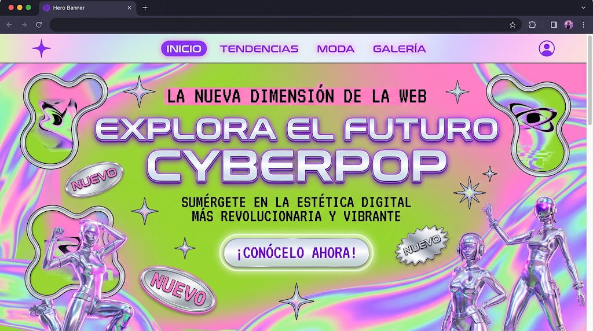

# Y2K / Cyberpop

Cromo, iridiscencia, píldoras, estrellas ✦ y blobs. Maximalista y lúdico. Encaja con **A**
(lanzamiento, evento) y **B** (moda).

## 1. Paleta de entrada
<!-- hex-allowed -->
| Rol | Ejemplo |
|---|---|
| cromo | `#E2E8F0` |
| rosa chicle | `#FF69B4` |
| púrpura eléctrico | `#A855F7` |
| verde lima | `#84CC16` |
<!-- /hex-allowed -->

## 2. Roles
- `primary`: púrpura (CTA, nav activo).
- `secondary`: cromo/plata para superficies metálicas y badges.
- `tertiary`: rosa; `cuaternary`: lima. El fondo iridiscente mezcla los cuatro.
- Fondo claro o medio; los textos sobre iridiscencia van sobre un panel sólido.

## 3. Tipografía
- **a (display/headline/title):** Unbounded · Righteous (extendida, redondeada).
- **b (base) y d (body/subtitle):** Rubik · Manrope. El subtítulo de la imagen es mono en
  mayúsculas: `JetBrains Mono` en `.text-subtitle` si se quiere igual; **el body sigue en
  Rubik**.
- **c (label, botones, badges):** Rubik 700 mayúsculas; pixel (Silkscreen) solo en
  etiquetas pequeñas, nunca en párrafos.
- `_text.scss`: display en mayúsculas, line-height 0.95, `letter-spacing: 0.02em`.
- No Syne (lista de impeccable).
## 4. Forma
`--radius-md: 32px` · `--form-radius-btn: var(--radius-pill)` · campos pill.

## 5. Gestos permitidos en `<slug>.scss`
- Relleno cromado con `linear-gradient` de 3–4 tokens + brillo interior.
- Fondo iridiscente animado muy lento (con fallback reduced-motion).
- Badges en píldora y estrellas ✦ como caracteres de texto (no imágenes).

## 6. Primitivas típicas
`Grid`+`Cell` con misma `row` para superponer badges y figuras · `Cluster` de píldoras ·
`Stack` centrado para el titular.

## 7. Qué muestra la imagen y cómo se construye

La imagen es el **comp aprobado** cuando el usuario la elige: se reproduce su composición
región por región ([comp-led.md](../comp-led.md)). El copy se reescribe para la marca; la
posición, la escala y el material se respetan.

| Región de la imagen | Kind | En este repo |
|---|---|---|
| Nav: estrella, "INICIO" en píldora púrpura, enlaces, icono de usuario | `chrome` | `Header` del toolkit; el item activo en píldora `.<slug>__pill--active` |
| Fondo holográfico rosa/verde/azul | `texture` | `Section` con `.<slug>__holo` (`conic-gradient` + `radial-gradient` de `tertiary`, `cuaternary`, `quinary`, `surface-bright`; animación lenta) |
| Estrellas cromadas dispersas | `plate` | `Icon name="Sparkle"` grande con `.<slug>__chrome-fill` (gradiente como `fill` vía `color`), en `Cell` con misma `row` |
| Blobs con ojo arriba a izquierda y derecha | `plate` | SVG blob propio con relleno `linear-gradient` de tokens + `Icon name="Eye"`; o foto de stock recortada |
| Etiqueta pequeña "LA NUEVA DIMENSIÓN DE LA WEB" | `text` | `Text variant="label"` mono mayúsculas, centrado |
| Titular cromado 2 líneas, enorme, borde púrpura | `text` | `Text variant="display"` + `.<slug>__chrome-text` (`background-clip: text`) y `-webkit-text-stroke` con `primary` |
| Subtítulo mono 2 líneas | `text` | `Text variant="subtitle"` |
| CTA píldora cromada con texto púrpura | `control` | `Button variant="primary"` con `primary-btn` = cromo (`cuaternary`) y `primary-btn-text` = `quinary` |
| Badges "NUEVO" rosa en píldora, rotados; starburst "NUEVO" | `plate` | `Text label` en `.<slug>__badge` con `rotate`; starburst = SVG polígono con `fill: var(--color-cuaternary)` |
| Tres figuras femeninas cromadas (abajo izq., derecha) | `plate` | **lo que no se puede generar:** fotos de stock de modelos con ropa metálica/plateada en `Media ratio="3/4"` ocupando el mismo lugar (`Cell` con misma `row`, `align="end"`), o hueco honesto. Ver [comp-led.md](../comp-led.md) §5 |

Es la imagen con más plates. Las figuras cromadas se sustituyen por fotos reales de las modelos de la marca en el mismo sitio: la composición se mantiene aunque el material cambie.

## 8. Anti-patrones
- Todo brilla: sin jerarquía, el CTA se pierde.
- Texto sobre fondo iridiscente sin panel: contraste imposible.
- Figuras 3D de stock como relleno.
