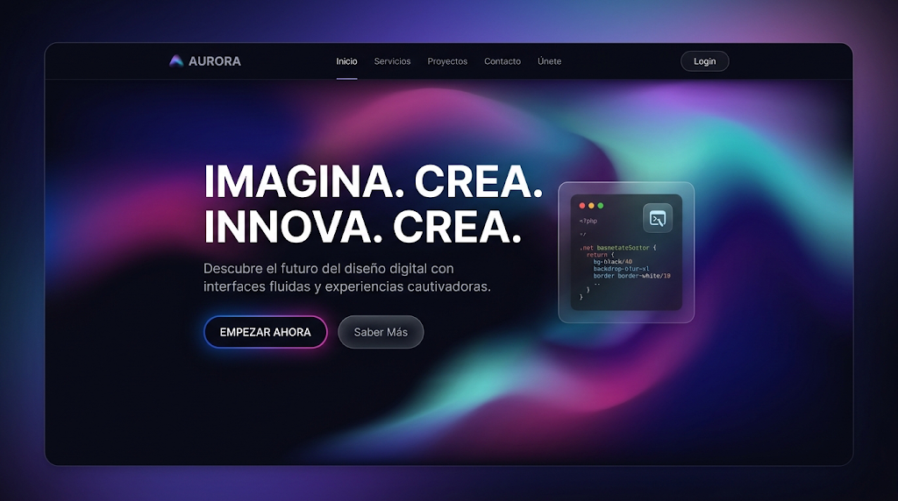

# Aurora / malla de gradiente

Lienzo oscuro con mallas de luz que fluyen; las secciones se definen por zonas de luz, no
por líneas. Encaja con **C** y **A**.

## 1. Paleta de entrada
<!-- hex-allowed -->
| Rol | Ejemplo |
|---|---|
| surface | `#0A0A12` |
| luces | índigo `#4F46E5` · magenta `#C026D3` · turquesa `#14B8A6` · violeta `#7C3AED` |
<!-- /hex-allowed -->

## 2. Roles
- Landing **oscura**.
- `primary`: la luz del CTA (índigo o violeta).
- `tertiary`, `cuaternary`, `quinary`: las otras luces de la malla.
- `outline-variant`: blanco al 10 %.

## 3. Tipografía
- **a (display/headline/title):** Sora · Lexend, 600–700.
- **b (base) y d (body/subtitle):** Manrope · Figtree.
- **c (label, botones):** la de b, 500; `JetBrains Mono` solo dentro del panel de código.
- `_text.scss`: display en mayúsculas como la imagen, `letter-spacing: -0.01em`.
- No Plus Jakarta Sans ni Inter como display (lista de impeccable).
## 4. Forma
`--radius-md: 20px` · `--form-radius-btn: var(--radius-pill)`.

## 5. Gestos permitidos en `<slug>.scss`
- `.home__aurora`: malla de `radial-gradient` con tokens, animada muy lenta (≥ 12s) y
  estática con reduced-motion.
- Tarjeta oscura translúcida con blur y borde claro al 10 %.
- CTA con borde de gradiente animado o halo del `primary`.

## 6. Primitivas típicas
`Section` sin cortes duros entre secciones (mismo fondo, la malla cambia de posición) ·
`Container` + `Col lg 6/6` · `Stack` · `Media` para el panel de código/producto.

## 7. Qué muestra la imagen y cómo se construye

La imagen es el **comp aprobado** cuando el usuario la elige: se reproduce su composición
región por región ([comp-led.md](../comp-led.md)). El copy se reescribe para la marca; la
posición, la escala y el material se respetan.

| Región de la imagen | Kind | En este repo |
|---|---|---|
| Nav: logo "AURORA", 5 enlaces, "Login" en píldora | `chrome` | `Header` del toolkit con `showButton` |
| Aurora magenta/turquesa fluyendo detrás de todo | `texture` | `Section tone="base"` con `.<slug>__aurora` (2–3 `radial-gradient` con `color-mix`, keyframes ≥ 12 s) |
| Titular 2 líneas blanco pesado (col 1–6) | `text` | `Text variant="display" textColor="color-text-white"` |
| Bajada gris clara | `text` | `Text variant="subtitle" textColor="color-on-surface-var"` |
| Dos CTAs: borde de gradiente brillante + píldora oscura | `control` | `Button variant="primary"` + `.<slug>__glow-border`; `Button variant="secondary"` |
| Panel de código translúcido con 3 puntos (col 8–12) | `plate` | `Cell start={{lg:8}} span={{lg:5}}` con `.<slug>__glass` y `Text label` mono con el código real del producto; si no hay código, `Media` con captura |

El panel de código es honesto solo si hay producto técnico; para otra marca ocupa el lugar una foto en `Media ratio="4/3"` dentro del mismo vidrio.

## 8. Anti-patrones
- Malla que compite con el texto: el titular siempre sobre la zona más oscura.
- Animación rápida o que reacciona al scroll en todo el fondo.
